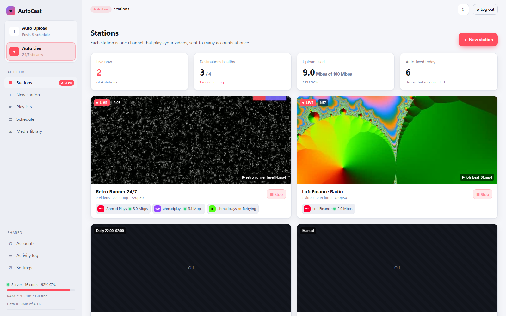
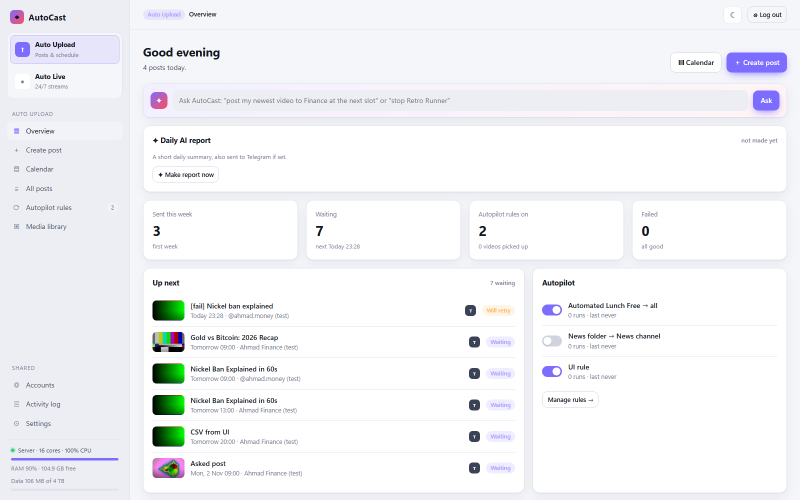
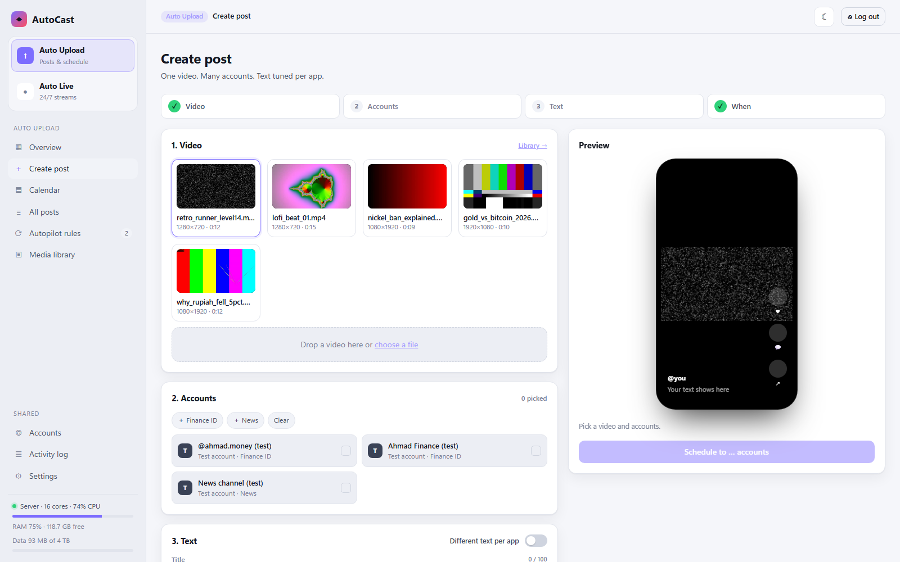
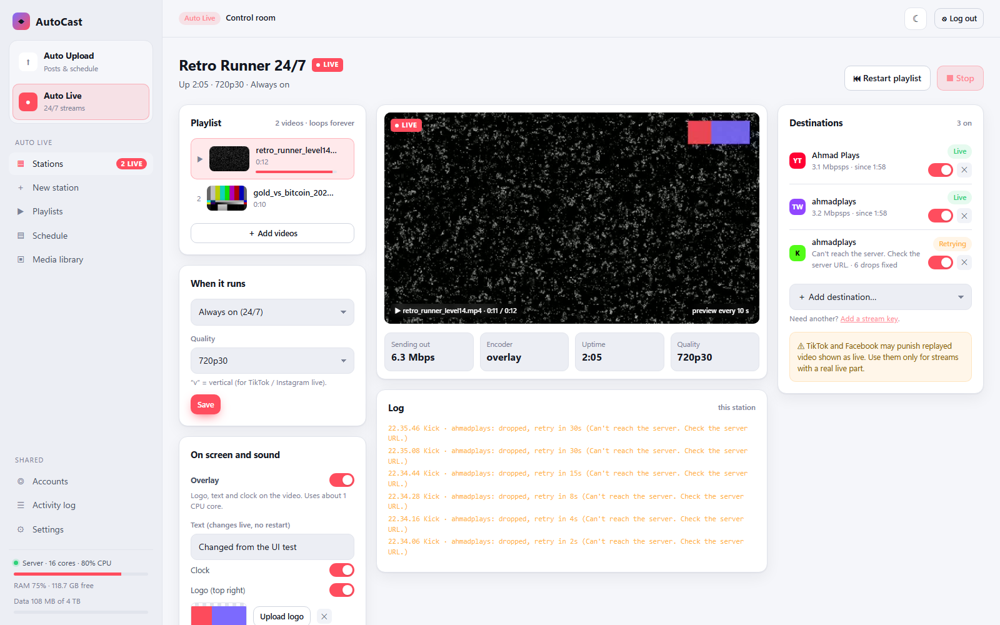
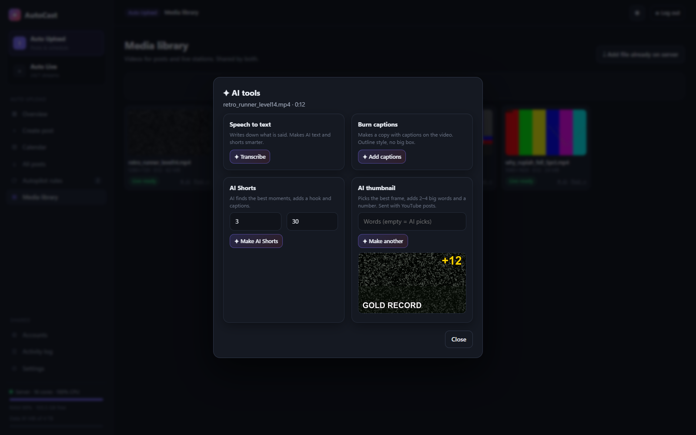
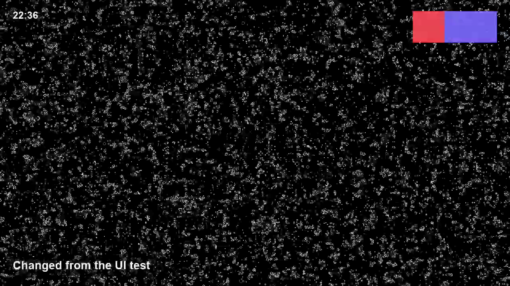
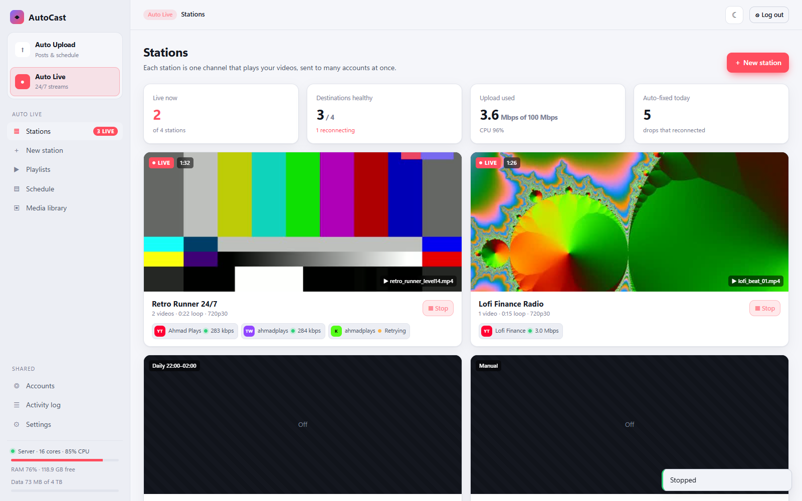

# AutoCast

**Self-hosted auto-posting and 24/7 multi-streaming, with AI built in.**
Run it on your own VPS. Post one video to many accounts, and keep live streams running nonstop on many platforms at once.



| | |
|---|---|
| **Auto Upload** | One video → YouTube, TikTok, Instagram Reels, Facebook Page. Text per app, calendar, free time slots, retries, folder autopilot, CSV import, repeat posts. |
| **Auto Live** | 24/7 stations that loop your videos to YouTube, Facebook, Twitch, Kick, TikTok LIVE, Instagram LIVE, X or any RTMP server, all at once. Overlay, music, recording, schedules. |
| **AI** | Writes titles and text, makes Shorts, captions and thumbnails, checks posts for safety, adds live lines, explains errors, and takes plain-language commands. Works with any OpenAI-style service. |

## Features

<details open><summary><b>Auto Upload</b></summary>

- Post one video to many accounts, with different text per app
- **Now**, **next free slot** (per-account post times) or **pick a time**
- Calendar with drag-to-move; list of all posts with retry and cancel
- **Autopilot rules**: every new video in a folder gets posted, with a same-name `.json` for its text
- **Push from your PC**: a small script sends new videos to the server (no shared folder needed)
- Auto **9:16 vertical** for TikTok and Instagram (blurred background, no black bars)
- **Shorts cutter**, **snippets** (saved hashtag sets), **repeat posts**, **bulk CSV import**
- **Duplicate guard** and a **daily limit** per account, to avoid spam flags
- Retries (1, 5, 15 min), clear errors, Telegram alerts
</details>

<details open><summary><b>Auto Live</b></summary>

- **Stations**: a playlist that loops forever, sent to many destinations at once
- Each destination reconnects **on its own**. One bad key never stops the others.
- Videos are prepared once, so a running station uses **almost no CPU**
- **Overlay**: logo, text (change it live, no restart) and clock
- **Background music** under the video, **recording** to hour-long files
- **Folder playlist**: new videos in a folder join the live playlist by themselves
- **Schedules**: manual, always on, or daily between two times (also across midnight)
- Login-based live for YouTube and Facebook, or a stream key for anything
- Live preview, health per destination, monthly data meter with an 80% alert
</details>

<details open><summary><b>AI (17 tools)</b></summary>

Write post · 5 title ideas · rewrite per app · translate · speech to text · burned-in captions · AI Shorts (best moments + hook) · AI thumbnail (best frame + big words + number) · YouTube custom thumbnail · safety check before posting · AI text for autopilot · live AI ticker · live "now playing" line · **Ask AutoCast** (type a request, confirm the plan) · explain errors · daily AI report · best posting times.
</details>

<details><summary><b>Shared</b></summary>

Accounts (OAuth login or stream key, groups, encrypted tokens) · media library · activity log · backup download · light/dark mode · one admin password.
</details>

## Screenshots

| | |
|---|---|
|  |  |
|  |  |
|  |  |

## Quick start (VPS, Ubuntu/Debian)

```bash
git clone https://github.com/Exeloxylade/autocast.git
cd autocast
PUBLIC_URL=https://cast.yourdomain.com WITH_CADDY=1 ./install.sh
```

Then open `https://cast.yourdomain.com` and make your password. Full steps, including setups that already use nginx or Caddy: **[docs/INSTALL.md](docs/INSTALL.md)**.

Just want to look around on your own PC? See [Try it locally](docs/INSTALL.md#try-it-locally-no-vps).

## Documentation

| Guide | What's in it |
|---|---|
| [Install](docs/INSTALL.md) | VPS install, HTTPS, existing nginx/Caddy, updates, backups, trying it locally |
| [Platforms](docs/PLATFORMS.md) | Making the Google, Meta and TikTok apps, stream keys, limits and approvals |
| [User guide](docs/USER-GUIDE.md) | Every screen of Auto Upload, Auto Live and Shared |
| [AI](docs/AI.md) | Connecting an AI service and using each AI tool |
| [Push from PC & API](docs/API.md) | `tools/push.js`, the upload hook, CSV format, sidecar `.json` |
| [Troubleshooting](docs/TROUBLESHOOTING.md) | Common problems and fixes |
| [Security](docs/SECURITY.md) | How secrets are stored, what to back up, how to report a problem |
| [Development](docs/DEVELOPMENT.md) | How it works inside, tests, project layout |

## How live works

```
playlist ─► prepare once (same size, fps, no B-frames)
        ─► ENCODER (video copied; optional overlay) ─► RELAY (MediaMTX) ─┬► pusher ─► YouTube
                                                                         ├► pusher ─► Twitch
                                                                         └► pusher ─► Kick …
```

## Good to know

- Each platform must approve your app before public posting works fully. See [Platforms](docs/PLATFORMS.md).
- TikTok and Facebook may punish replayed video shown as "live". Use file loops there with care.
- AutoCast uses official APIs and your own logins. You are responsible for following each platform's rules.

## License

[MIT](LICENSE). Use it, change it, share it.
