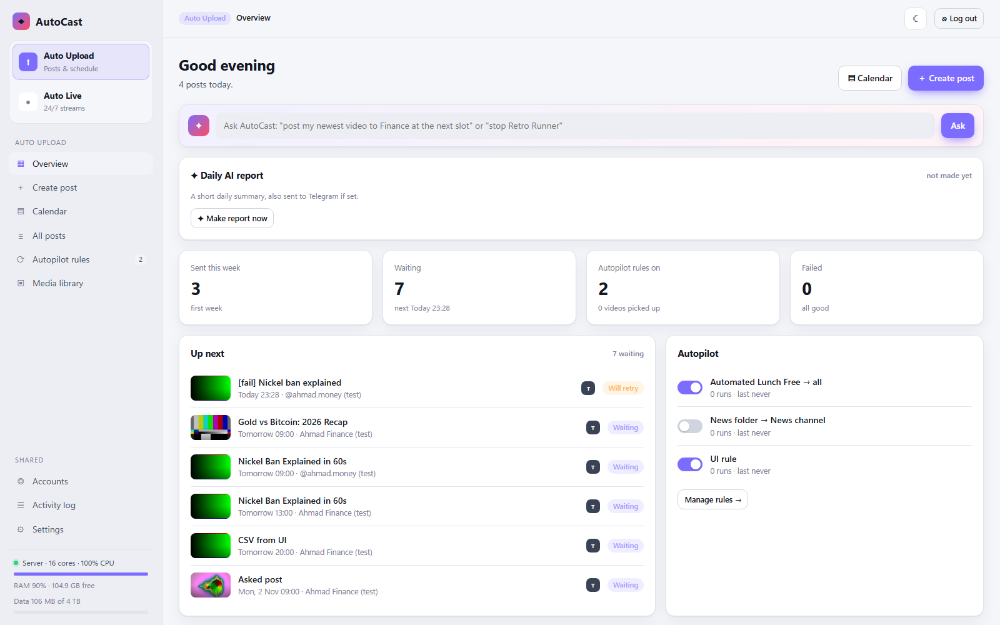
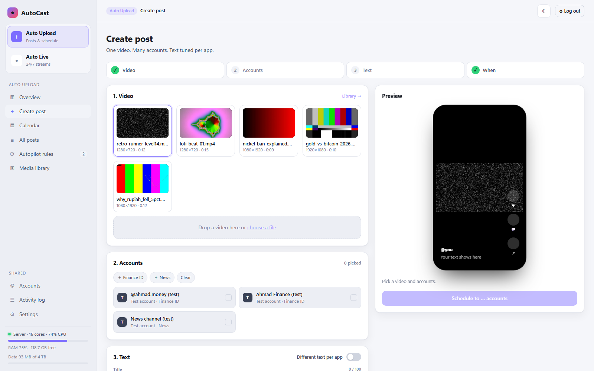
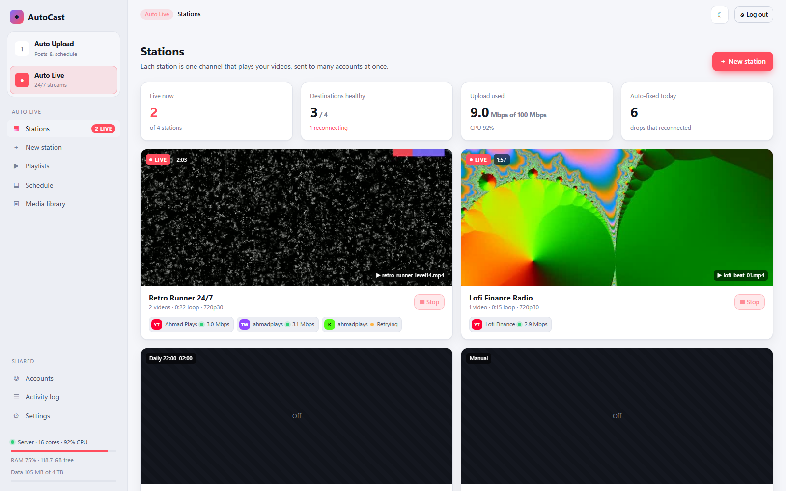
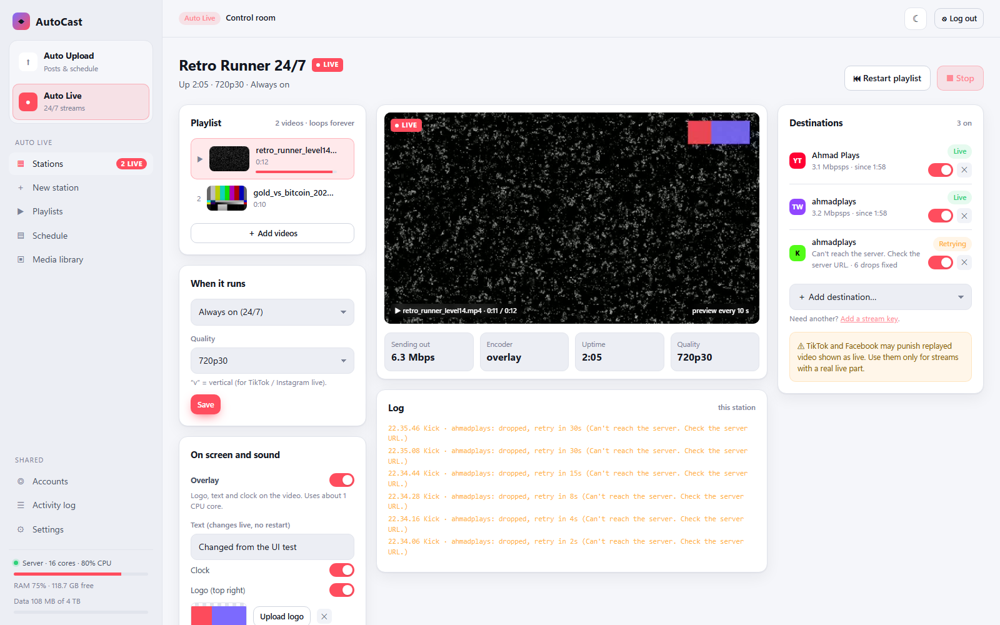
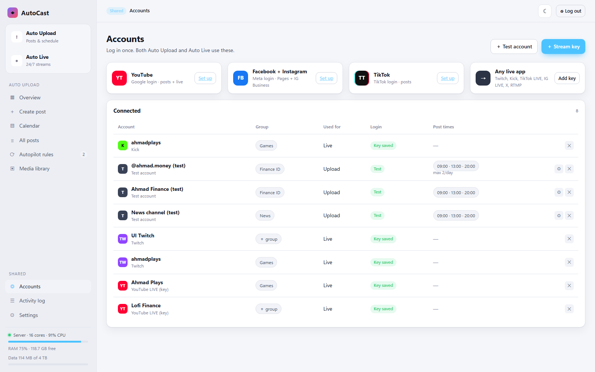

# User guide

AutoCast has two separate parts, picked at the top left:

- **Auto Upload** (purple): posts and schedules
- **Auto Live** (red): 24/7 streams

**Shared** (bottom left) holds Accounts, Activity log and Settings, used by both. The ☀ / ☾ button at the top switches light and dark mode.

---

## Auto Upload

### Overview



- **Ask AutoCast**: type a request like *"post my newest video to group Finance at the next slot"*. You see the plan first, then press **Do it**. Needs AI.
- **Daily AI report**: a short summary of the last 24 hours.
- Counts: sent this week, waiting, autopilot rules, failed.
- **Up next**, **Autopilot** on/off switches, and the **last 7 days** with links to each post.

### Create post



1. **Video**: pick from the library, or drop a new file.
2. **Accounts**: tick accounts, or click a group chip.
3. **Text**: title and description.
   - Snippet chips add saved hashtags or lines. **☆ Save as snippet** saves the current description.
   - **Different text per app** shows one tab per app.
   - AI buttons: **Write with AI**, **Rewrite per app**, **Translate to…**, **Check safety**. Title ideas show as chips; click one to use it.
   - **Options**: privacy, *Made with AI* label, *Made for kids*.
4. **When**: *Now*, *Next free slot* (each account's post times) or *Pick time*.
   - **Post again later**: repeat every N days, M more times.
   - **Allow repeat**: skips the "already posted" check.

The preview on the right checks the video shape, length limits per app, and logins. The button stays off until everything is fine.

### Calendar

Week view. Drag a waiting post to another day (it keeps its time). Click any post to see it, move it, cancel it or send it again. Filter by app.

### All posts

Tabs: **Waiting**, **Sent**, **Failed**, **All**. Click a row for details. Failed posts have **Send again** and **✦ Explain this error**.

**⇪ Import CSV** makes many posts at once. Format: [API.md → CSV](API.md#csv-import).

### Autopilot rules

"A new video lands in this folder → post it."

| Field | Meaning |
|---|---|
| Folder | A folder **on the server**, like `/data/watch/exports` |
| Post to | The accounts |
| Title / Description | Templates: `{title}`, `{description}`, `{tags}`, `{name}`, `{date}` |
| When | Next free slot, or right away |
| ✦ AI writes the text | Used when the video has no `.json` next to it |
| ✦ AI thumbnail | Makes a thumbnail for each new video |

Only videos added **after** the rule is made are posted. Files still being written (changed in the last 10 s) wait.

**Sidecar `.json`**: put `video.json` next to `video.mp4`:

```json
{ "title": "Gold vs Bitcoin: 2026", "description": "Which one won?", "tags": ["gold", "bitcoin"] }
```

### Media library

Drop videos, or **Add file already on server** (no copy). Each card shows size, length and whether it is ready for live. Links:

- **✦ AI**: speech to text, burn captions, AI Shorts, AI thumbnail ([AI.md](AI.md))
- **✂ Shorts**: cut into N vertical clips spread through the video (no AI)
- **Post →**: opens Create post with this video

---

## Auto Live

### Stations



A **station** is one channel: a playlist that loops forever, sent to many destinations. Each card shows a live preview, uptime, now playing and the health of each destination. **Start** and **Stop** work from here.

Top numbers: live now, healthy destinations, upload used, drops fixed today.

### New station

1. **What plays**: name, quality (`720p30`, `1080p30`, `1080p60`, or `v` = vertical for TikTok/Instagram live), videos.
2. **Where it goes**: live accounts (login or stream key).
3. **When**: Manual, Always on, or Every day between two times.

Videos are **prepared once** (same size, frame rate and sound). After that the station only copies the video, so it uses almost no CPU.

### Control room



| Part | What you can do |
|---|---|
| Playlist | See what plays now, move up, remove, **＋ Add videos** (applies within seconds) |
| When it runs | Manual / always / daily times, quality |
| On screen and sound | **Overlay** (logo, text, clock), **✦ AI line**, **background music**, **record** |
| Preview | A new picture every 10 s, now playing, send rate |
| Log | This station's events |
| Destinations | Health per destination, on/off switch, remove, **＋ Add destination** |

Notes:

- Overlay **text changes live**. Turning the overlay or music on or off restarts the picture (a few seconds).
- The overlay re-encodes video and uses about 1 CPU core at 720p.
- One account can be live on only **one** station at a time.
- **Restart playlist** goes back to the first video.

### Playlists

Every station has one. **📁 Link folder** makes it fill itself: new videos in that server folder join the playlist, even while live. **Shuffle** mixes the order.

### Schedule

All stations' on/off times in one table. "Daily 22:00–02:00" crosses midnight correctly.

---

## Shared

### Accounts



- **Log in** buttons for YouTube, Facebook + Instagram, TikTok
- **＋ Stream key** for any live app
- **＋ Test account**: a fake account. Posts are saved to the server's `data/mock-out` folder. Good for trying things.
- Per account: group, post times, **⚙** (video shape, daily limit, ✦ suggested times), remove

### Activity log

Everything the server did. Filter by part (Upload, Live, Accounts, Media) and by problems only, and search.

### Settings

| Card | What |
|---|---|
| Google / Meta / TikTok app | App keys + redirect URI to copy |
| Alerts | Telegram bot token and chat ID; alerts for failed posts and dropping lives |
| Live and storage | Default quality, your upload limit, monthly data limit, auto-delete old unused videos |
| ✦ AI | Service, key, models, language, safety mode, daily report time |
| Push from your PC | Make tokens for `tools/push.js` |
| Posting rules | Duplicate guard days |
| Backup | Download the database |
| Server | Version, CPU, RAM, disk, relay and FFmpeg status, **change password** |
